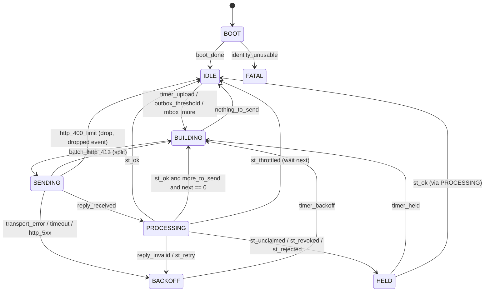

# 08. State machines and process flows

Status: **Draft 0 (format proposal)**, 14 Nov 2026. Depends on specs 01–07.

Specs 01–07 fix formats and guarantees. Behaviour is spread through their prose. This spec makes behaviour explicit: every component that has state gets a state machine written in one fixed format, and every multi-party procedure gets a sequence diagram. Where the earlier specs are silent, this spec does not invent behaviour: it raises a numbered question (§5) and marks the transition **Proposed**.

This draft contains the format (§1), the inventory of every machine and flow (§2, §3), one machine written in full as the worked example (§4: device runtime), and the questions that writing it raised (§5). The rest follows once tom approves the format.

## 1. Format

Every state machine has these parts, in this order.

1. **Purpose and owner.** What it controls, which component runs it, which spec sections it implements.
2. **States.** One table: state, meaning, what is persisted while in it.
3. **Diagram.** Mermaid `stateDiagram-v2`. The diagram is a picture of the table; the table is normative.
4. **Transition table.** Columns: `#`, from, event, guard, actions, to, spec. Every (state, event) pair that can occur either has a row or is listed under "ignored events" for that state. A pair that appears in neither is a spec bug.
5. **Crash and power-loss behaviour.** For every state: what the machine resumes in after a reset at any instant, and why no invariant breaks.
6. **Timers and limits.** Every timer, retry count and bound, with its value or the configuration key that sets it.
7. **Invariants.** The properties the machine maintains, referenced to spec 06 §1 (I1–I8) where they apply.
8. **Test hooks.** The simulator scenarios (spec 07) and model-check properties (§1.1) that exercise it.

Rules for writing transitions:

- **Events** are named in `snake_case` and are either external (`reply_received`, `timer_upload`) or internal (`batch_built`).
- **Guards** are side-effect free and use only state the machine owns.
- **Actions** run in the order listed. An action that persists something says `persist(...)`; the transition is not complete until the persist has returned. Crash behaviour (part 5) is written against these persist points.
- A transition that is not yet backed by an earlier spec is marked **Proposed** with a §5 question number.

### 1.1 Formal models

Machines whose bugs lose, duplicate or misroute data get a formal model in addition to the tables: device outbox and acks (S1, S2), cloud series state (C1), the gateway queue (G3), mailbox delivery (C2, S5) and moves (C4). The model is written in TLA+ (checked with TLC) or P, lives in `spec/models/`, and is checked in CI with bounded parameters (for example 2 devices, 2 series, 6 samples, any interleaving of crashes, drops, duplicates and reorders). The properties checked are the invariants of part 7 and spec 06 §1. Choice of language is §5 Q1.

## 2. Inventory of state machines

Status: **Prose** = behaviour exists in specs 01–07 but not as a machine; **Gap** = not specified anywhere yet; **Model** = needs a formal model (§1.1).

### 2.1 Device (SDK, all targets)

| # | Machine | Controls | Where it is today | Status |
|---|---|---|---|---|
| S1 | **Runtime** | Boot, sampling and upload cycle, backoff, held states | spec 01 §5, §7, §9; spec 03 §3.6, §6.1 | Prose; written in full in §4 |
| S2 | **Outbox and storage** | Append, index, select for batch, free on ack, overflow and `dropped`, corruption and `inc` reset | spec 01 §5.2, §5.3, §7.1, §7.5 | Prose + Gap (storage layout); Model |
| S3 | **Series counters** | Assign seq at capture, persist block, resume on boot, `boot_skip`, wrap | spec 01 §5 | Prose |
| S4 | **Clock** | Unsynced → synced per boot, sources and precedence, `time_sync` | spec 01 §8, spec 02 §5.4 | Prose + Gap (source precedence, drift) |
| S5 | **Mailbox processor** | Accept, reject, apply, defer items; `last_id`; result memory of 8 | spec 01 §7.2, §7.3 | Prose; Model |
| S6 | **Config** | Apply set/unset atomically, hash, rollback on failure, `rcfg` | spec 01 §7.2, spec 04 §4 | Gap (atomicity on power loss) |
| S7 | **Firmware update** | Download, verify, stage, swap, confirm, rollback | spec 01 §7.2 type 3 (hook) | Gap (Phase 1 OTA spec) |
| S8 | **Lifecycle** (device view) | Factory, unclaimed, claimed, unclaimed again, revoked | spec 03 §2, §3, §8 | Prose |
| S9 | **Network attach** | Thread join / WiFi connect, commissioning, loss and re-attach | — | Gap |
| S10 | **Module slot** | Module detected, identified, swapped, removed | spec 01 §4.2, spec 04 §5 | Prose + Gap (detection) |
| S11 | **Power profile** | Sleep, wake sources, battery thresholds, brownout handling | — | Gap |

### 2.2 Gateway (border router firmware)

| # | Machine | Controls | Where it is today | Status |
|---|---|---|---|---|
| G1 | **Lifecycle** | Provisioned, certificate issued, active, renewing, revoked | spec 03 §5 | Prose |
| G2 | **Relay loop** | Collect batches and polls, POST relay, distribute replies | spec 02 §4, §7 | Prose |
| G3 | **Store and forward** | Per-device queue, eviction, oldest first | spec 02 §7 | Prose; Model |
| G4 | **Reply cache** | Hold signed replies for sleepy devices, expiry | spec 02 §7 | Prose |
| G5 | **Certificate renewal** | Renew before expiry, fail-safe if renewal fails | spec 03 §5 | Gap |
| G6 | **OTA proxy** | Fetch, verify, cache, pace device downloads | spec 02 §7 (Phase 1) | Gap |
| G7 | **Thread network** | Border router role, partitions, commissioning devices | — | Gap |

### 2.3 Cloud

| # | Machine | Controls | Where it is today | Status |
|---|---|---|---|---|
| C1 | **Series state** (per dev, inc, series) | Accepted / reserved / unknown, publish decision, ack computation, gaps | spec 06 §3 | Prose; Model |
| C2 | **Mailbox item** | Created, queued, delivered, received, applied / failed / rejected / expired, superseded | spec 01 §7.2–7.3 | Gap (server side); Model |
| C3 | **Device lifecycle** (registry) | Registered, unclaimed, claimed, moving, revoked, retired | spec 03 §2–§3, §8 | Prose |
| C4 | **Move** | Requested, boundary item sent, boundary received, routes switched, complete; cancel and timeout | spec 05 §5 | Prose; Model |
| C5 | **Claim** | Code entered, validated, claimed; pre-assignment; order tokens | spec 03 §3 | Prose |
| C6 | **OTA rollout** | Draft, staged waves, paused, halted on failure rate, complete | — | Gap |
| C7 | **Key rotation** | Reply key rollover, device key rotation (Later), CA rotation | spec 02 §5.2, spec 03 §9 | Prose + Gap |
| C8 | **Ingest pod** | Starting, directory loading, ready, degraded (fail closed), draining | spec 03 §8 | Prose |
| C9 | **Storage worker** | Consume, batch, insert, commit; retry and quarantine | spec 06 §4 | Prose |
| C10 | **Rollup** | Dirty hours, recompute, published | spec 06 §8 | Prose |
| C11 | **Gateway lifecycle** (registry) | Mirror of G1 on the server | spec 03 §5 | Prose |
| C12 | **Retention** | Class assignment, effective dating, deletion | spec 06 (retention) | Prose |

## 3. Inventory of process flows

Each flow becomes a sequence diagram (Mermaid `sequenceDiagram`) with every party as a lane, numbered messages, and a failure table: what happens if each message is lost, duplicated, delayed or the sender crashes after sending.

| # | Flow | Parties | Status |
|---|---|---|---|
| F1 | Factory registration | Jig, factory CA, core, HSM | Prose (spec 03 §2.2) |
| F2 | First boot to first ack, direct device | Device, ingest, Redis, Redpanda | Prose |
| F3 | First boot to first ack via gateway | Device, gateway, ingest | Prose |
| F4 | Claim by user | Installer, portal, core, device | Prose (spec 03 §3.2) |
| F5 | Upload with partial loss and resend | Device, (gateway), ingest | Prose |
| F6 | Config change end to end | User, core, mailbox, device, `mres` | Gap (server side) |
| F7 | Command end to end | User, core, mailbox, device | Gap |
| F8 | Move between orgs | Admin, core, device, workers | Prose (spec 05 §5) |
| F9 | Long outage and backlog drain | Device, gateway, ingest, workers | Prose (spec 01 §7.5) |
| F10 | Platform outage (Redpanda / ClickHouse down) and recovery | Ingest, workers, devices | Prose (spec 06) |
| F11 | Firmware rollout in waves | Operator, core, gateway, devices | Gap |
| F12 | Revocation | Admin, core, directory, ingest | Prose (spec 03 §8) |
| F13 | Unclaim and reclaim | User, core, device | Prose |
| F14 | Module swap in the field | Device, workers, registry | Prose |
| F15 | Factory reset of a claimed device | Device, ingest, workers | Prose (spec 01 §5.3) |
| F16 | Reply key rollover | Core, ingest, devices | Prose (spec 02 §5.2) |
| F17 | Gateway replacement | Installer, core, devices | Gap |
| F18 | Field recovery over serial (trust failure; memory loss and re-registration) | Customer admin, web app, device bootloader, core | Gap (spec 03 §11, Draft) |

## 4. S1: Device runtime (worked example)

### 4.1 Purpose and owner

Runs on every device, in the SDK's portable core. Decides when to sample, when to upload, what to do with each reply or failure, and when to hold off. It drives S2 (outbox), S3 (counters), S4 (clock) and S5 (mailbox) and does not duplicate their logic. Implements spec 01 §5, §7, §7.5, §9; spec 02 §3.5; spec 03 §3.6, §6.1.

Sampling and uploading are separate: sampling runs on its own timer in every state except `BOOT` and `FATAL`, because a sample must be captured and numbered at capture time (spec 01 §5.1 rule 2) whatever the network is doing.

### 4.2 States

| State | Meaning | Persisted while in it |
|---|---|---|
| `BOOT` | Load identity and counters, resume series, record boot | Nothing new until `boot_done` |
| `IDLE` | Waiting for the next upload time; sampling continues | `next_upload_at` (Proposed, Q3) |
| `BUILDING` | Selecting samples from the outbox and encoding a batch | Nothing (a batch is rebuildable) |
| `SENDING` | Batch sent, waiting for a reply or a transport failure | Nothing (an unacknowledged batch is still in the outbox) |
| `PROCESSING` | Verifying and applying a reply | Acks applied via S2, `last_id` via S5, clock via S4 |
| `BACKOFF` | No usable reply; waiting before retrying | `backoff_step` (Proposed, Q4) |
| `HELD` | Cloud says unclaimed, revoked or rejected; uploading slowly | `held_reason` |
| `FATAL` | Identity or key storage unusable; cannot sign | Nothing; reports via local indicator only |

### 4.3 Diagram

### 4.4 Transition table

| # | From | Event | Guard | Actions | To | Spec |
|---|---|---|---|---|---|---|
| 1 | `BOOT` | `power_on` | — | Load key, serial, `inc`; if counters unprovable: new `inc`, `persist(inc)` (S3); resume series (S3); increment and `persist(boot)`; append `boot` event; append `boot_skip` per series (S3) | `BOOT` | 01 §5.2, §5.3 |
| 2 | `BOOT` | `boot_done` | key usable | Start sample timer; schedule upload at `now + jitter(0, upload_interval)` | `IDLE` | 01 §5 |
| 3 | `BOOT` | `identity_unusable` | key missing or fails self-test | Signal locally | `FATAL` | 03 §2.4 |
| 4 | any but `BOOT`, `FATAL` | `timer_sample` | — | Capture; assign seq (S3); append to outbox (S2); reschedule | same | 01 §5.1 |
| 5 | `IDLE` | `timer_upload` | — | — | `BUILDING` | 01 §7 |
| 6 | `IDLE` | `outbox_threshold` | outbox ≥ `upload_threshold` (Proposed, Q2) | — | `BUILDING` | — |
| 7 | `BUILDING` | `build` | outbox empty and no pending `mres`, `rcfg` or poll due | Schedule next upload | `IDLE` | — |
| 8 | `BUILDING` | `build` | otherwise | Select live first then oldest (S2); add pending `mres` and `rcfg`; set `fl`; new nonce `n`; encode streaming; sign | `SENDING` | 01 §7.5, 02 §3.4 |
| 9 | `SENDING` | `reply_received` | — | — | `PROCESSING` | — |
| 10 | `SENDING` | `transport_error`, `timeout` | — | `backoff_step += 1` | `BACKOFF` | 01 §7.5 |
| 11 | `SENDING` | `http_503` | — | Use `Retry-After` with jitter as the backoff delay | `BACKOFF` | 01 §9 |
| 12 | `SENDING` | `http_413` | batch has > 1 sample | Halve batch size limit for this upload | `BUILDING` | 01 §9 |
| 13 | `SENDING` | `http_400`, `http_401`, `http_415` | same bytes sent < 3 times | `backoff_step += 1` | `BACKOFF` | 01 §9 |
| 14 | `SENDING` | `http_400`, `http_401`, `http_415` | same bytes sent 3 times **(C34: to be replaced by the `rejected_upload` policy, spec 06 §12; default `hold`)** | Discard those samples from outbox (S2); append `dropped` reason 2 | `IDLE` | 01 §9 |
| 15 | `PROCESSING` | `verify` | signature invalid, unknown `kid`, `dev` not own serial | Count `reply_invalid`; `backoff_step += 1` | `BACKOFF` | 02 §3.5 |
| 16 | `PROCESSING` | `verify` | valid, `inc` ≠ own | Ignore acks; mailbox handling per Q5 | `IDLE` | 01 §7, 02 §3.5 |
| 17 | `PROCESSING` | `verify` | valid, `inc` = own | Set clock from `now` if unsynced and `n` matches (S4); apply acks (S2); process `mbox` (S5); queue `resend` ranges as priority (S2); `backoff_step = 0` | (by `st`, rows 18–22) | 01 §7.1–7.3, §8 |
| 18 | `PROCESSING` | `st = 0` | more to send and `next = 0` | — | `BUILDING` | 01 §7.5 |
| 19 | `PROCESSING` | `st = 0` | otherwise | Schedule upload at `max(next, upload_interval if nothing pending)` (Q3) | `IDLE` | 01 §7 |
| 20 | `PROCESSING` | `st = 1` | — | Schedule upload at `next` | `IDLE` | 03 §6.1 |
| 21 | `PROCESSING` | `st = 2, 3, 5` | — | `persist(held_reason)`; schedule at `next` | `HELD` | 03 §3.6, §8 |
| 22 | `PROCESSING` | `st = 4` | — | Schedule at `next` | `BACKOFF` | 01 §9 |
| 23 | `BACKOFF` | `timer_backoff` | — | — | `BUILDING` | 01 §7.5 |
| 24 | `HELD` | `timer_held` | — | — | `BUILDING` | 03 §3.6 |
| 25 | `HELD` | (reply `st = 0` via row 19) | — | Clear `held_reason` | `IDLE` | — |

**Ignored events:** `timer_upload` in `BUILDING`, `SENDING`, `PROCESSING`, `BACKOFF`, `HELD` (the machine is already on its way to an upload or deliberately waiting). `outbox_threshold` outside `IDLE`. Any event in `FATAL` except `power_on`.

### 4.5 Crash and power-loss behaviour

A reset can happen at any instant. On power-up the machine always enters `BOOT` (row 1). This is safe in every state because the runtime keeps no state that the outbox, counters and `last_id` do not already hold:

| Reset while in | Lost | Why nothing breaks |
|---|---|---|
| `BOOT` | Possibly the `boot` or `boot_skip` event not yet appended | Row 1 runs again; resume rule takes `max(persisted block + 1000, outbox max + 1)`, so numbers never repeat (01 §5.2) |
| `IDLE`, `BUILDING` | The schedule; the unbuilt batch | Samples are still in the outbox; the next boot uploads them |
| `SENDING` | The reply | Samples were never deleted (I1); the resend is de-duplicated by the cloud (I3) |
| `PROCESSING` | Part of the reply's effects | Acks are idempotent and monotonic (01 §7.1); mailbox items at or below the persisted `last_id` are rejected as replays, above it are re-received and re-applied by S5 (Q6: config apply must be atomic) |
| `BACKOFF`, `HELD` | The backoff step or the held flag, unless persisted | At worst the device uploads once early after boot and is told again |

### 4.6 Timers and limits

| Name | Value | Set by |
|---|---|---|
| `sample_interval` | Product config | Schema config (spec 04 §4) |
| `upload_interval` | Product config, 30–300 s typical | Schema config |
| `upload_threshold` | Proposed: 75 % of one batch's capacity (Q2) | SDK profile |
| `reply_timeout` | Proposed: 30 s direct, 120 s via gateway (Q7) | SDK profile |
| Backoff | 10 s × 2^step, capped at `upload_interval`, full jitter | spec 01 §7.5 |
| Same-bytes retry limit | 3 | spec 01 §9 |
| Batch size limit | Transport limit (spec 01 §10), halved on 413 | spec 01 §9, §10 |

### 4.7 Invariants

- **I1 (device side):** no transition deletes a sample except row 17 via S2 on a verified ack for the device's own `inc`, and row 14 which also records a `dropped` event so the gap is declared.
- A sample is numbered once, at capture (row 4), in every state but `BOOT` and `FATAL`.
- No action is taken on reply content before row 15/17 verification.
- Every path from `SENDING` reaches `IDLE`, `BACKOFF`, `HELD` or `BUILDING`; there is no state in which the device stops trying to upload, except `FATAL`.

### 4.8 Test hooks

- Simulator device model implements this table directly (spec 07 §6); its transition coverage is reported per run, and every row must be hit by the scenario suite.
- Scenarios: spec 07 §2.7–2.15, P1–P6, G2, M4.
- Model-check properties (with S2): "every sample captured is eventually acked or declared dropped, under fair delivery"; "no sample is deleted without a covering ack".

## 5. Questions raised by §4

Each needs an answer before §4 leaves draft. Proposed answers are what §4 currently assumes.

| # | Question | Proposed answer |
|---|---|---|
| Q1 | TLA+ or P for formal models? | TLA+ with TLC: mature, widely reviewed, small models suffice. P if we later want generated test harnesses |
| Q2 | Should a full outbox trigger an early upload, or only the timer? | Yes, at 75 % of one batch's capacity, so bursty sampling does not wait a full interval |
| Q3 | When nothing is pending, does `next` override the product's upload interval? | Device waits `max(next, upload_interval)`; `next` can only slow a device down, except `next = 0` while draining |
| Q4 | Persist the backoff step across reboot? | No: a reboot is a fresh start; one early upload is harmless |
| Q5 | A valid reply for an old `inc`: ignore all of it, or still process mailbox items? | Ignore all of it; mailbox items are re-sent with the current `inc` |
| Q6 | Config apply must survive power loss mid-apply: double-buffered config with a commit marker? | Yes; specified in S6 |
| Q7 | Reply timeout values per transport? | 30 s direct, 120 s via gateway (sleepy devices may wait for the gateway's next relay) |
| Q8 | Poll for a device with nothing to send but `more` set: heartbeat record as in spec 03 §4? | Yes, for both paths |
| Q9 | Customer scenarios X2 / C30: should a synced boot's `time_sync` be repeated in every later envelope carrying that boot's uptime samples? | Yes; S4 persists the sync point per boot and S1 row 8 adds it when building a batch |
| Q10 | Customer scenarios X1 / C29: worker (C9) behaviour for samples past the late window | Store them normally; quarantine only impossible times; `expired_on_arrival` is declared |
| Q11 | Customer scenarios X8: pre-trigger ring buffers versus "numbered at capture" (spec 01 §5.1) | Open: to be settled in S3 (series counters) before that machine is written |

